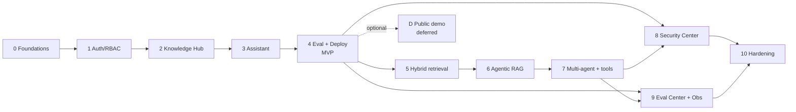

# Office-Mates — Development Checklist & Roadmap

> Companion to [BLUEPRINT.md](BLUEPRINT.md). Status: **approved 2026-11-16 — Phase 0 complete 2026-11-17; Phase 1 next.**
> Each phase ends with: tests green in CI, docs/ADR updated, a short demo of the working slice, and an honest "what is and isn't done" note.

Legend: **[MVP]** required for the first private deployment · **[ADV]** advanced · 🔒 security-critical · 📏 must be measured with evals

---

## Definition of Done (applies to every task)
- [ ] Code typed (mypy / tsc strict where configured), linted (Ruff / ESLint)
- [ ] Unit tests; integration tests for anything touching MySQL, Pinecone (real service, throwaway namespaces), Redis or LLM gateway (LLM mocked in CI)
- [ ] Authz + tenant-isolation tests for every new endpoint/tool 🔒
- [ ] Errors return Problem Details; no stack traces to clients
- [ ] Logs/traces carry `request_id`/`trace_id`, contain no secrets
- [ ] Docs updated (README section, ADR for non-trivial decisions)
- [ ] No feature claimed in README/UI until it works end-to-end

---

## Phase 0 — Foundations [MVP]
**Goal:** empty-but-real skeleton that builds, tests and runs locally.
- [x] Initialise git repo, monorepo layout (§2.5), `.gitignore`, `.gitattributes`, `.editorconfig`, licence: private/all rights reserved — public GitHub repo
- [x] Backend: uv project, FastAPI app factory, settings (pydantic-settings), structlog, Problem Details error handler, `/healthz` `/readyz` `/version` — 21 tests, Ruff + mypy strict clean
- [x] Frontend: Next.js 16 + TS + Tailwind + shadcn/ui, app shell layout, theme, typed API client (OpenAPI-generated) + live status card — 7 Vitest tests, ESLint + tsc clean, verified in browser
- [x] Docker Compose: mysql 8.4, redis, SeaweedFS (S3 stand-in; MinIO images no longer exist), api, worker (minimal Celery app + `system.ping`), web — all verified running; Redis readiness check in `/readyz` *(Pinecone Local removed 2026-11-17: end of life)*
- [x] Pinecone behaviour check: Pinecone Local turned out to be end-of-life, so a contract suite now verifies namespaces, metadata filters, list-by-prefix, delete and namespace deletion against the real service (12 tests); Starter limits re-checked (§11.4)
- [x] SQLAlchemy (asyncmy) + Alembic baseline; MySQL users (`app_rw`, `migrator`, `readonly_ops`), utf8mb4 + UUIDv7 `BINARY(16)` and UTC `DATETIME(6)` types; MySQL check in `/readyz`; migrations run as a one-shot Compose job — 49 tests incl. 10 against real MySQL
- [x] Pre-commit: gitleaks, `.env` blocker, private-key/large-file/merge-conflict checks, Ruff, mypy, ESLint, Prettier, tsc 🔒 — verified to block a fake token and a `.env` file
- [x] GitHub Actions `ci.yml`: secret scan (full history), backend lint/types/tests with a MySQL service, web lint/types/tests/build, API-contract check, Docker stack smoke test — *green on GitHub from 64320cb (first run failed on a fresh-checkout typecheck bug, fixed)*; Pinecone contract tests run when the `PINECONE_API_KEY` repo secret is set
- [x] ADRs 001–005 (monorepo, tenancy, vector isolation, LLM gateway, hosting profile) — in [adr/](adr/README.md); 002–005 are accepted designs, built in Phases 1–4
- **Exit:** `docker compose up` → web shows shell, `/readyz` green, CI green.
- ✅ **Done 2026-11-17.** Demo: `docker compose up --build -d --wait` → api, worker, web, mysql, redis, s3 healthy; `/readyz` ok (mysql, redis); web shell shows "Operational". CI green on `f685026`.
  - **Works:** the skeleton only — health endpoints, app shell, local stack, DB foundation (no app tables), pre-commit, CI, ADRs 001–005, Pinecone contract tests.
  - **Not done / known gaps:** no product features; Pinecone and S3 are not used by the app yet and have no `/readyz` check; the web shell's sidebar features are disabled placeholders; the worker has only a ping task.

## Phase 1 — Identity, tenancy, RBAC [MVP] 🔒
- [x] Models: tenants, users, memberships, refresh_tokens, audit_logs — migrations 0002–0003; audit log append-only via triggers *(invitations table comes with the invitation flow)*
- [x] `TenantContext` + `TenantScopedMixin` + fail-closed ORM hooks (`do_orm_execute` criteria, `before_insert` stamping, raise without context) + audited `system_scope()` 🔒 — also catches tenant tables that are only joined/subqueried, refuses bare Core tables and bulk `tenant_id` updates; *system scope is logged, not yet written to audit_logs*
- [ ] Composite FKs `(tenant_id, id)` on child tables; raw-SQL lint rule outside repositories 🔒 — *`tenant_foreign_key()` + a test that every tenant→tenant FK is composite (no such child tables yet); Core-table access is refused at runtime; `text()` lint rule still to do*
- [x] Register (dev only), login, refresh rotation with reuse detection, logout; Argon2id — reuse revokes the whole session family and kills its access tokens; failures look identical for unknown email and wrong password
- [x] Cookie-based JWT, CSRF protection, strict CORS, security headers (CSP, HSTS) — HttpOnly access/refresh cookies, double-submit CSRF on every state-changing API call, JSON-only session-start endpoints; *web app CSP comes with the frontend slice*
- [ ] `require_permission()` dependency + role→permission map
- [ ] Invitations: admin invites user → accept-invitation sets password; public sign-up disabled outside local
- [ ] Login rate limiting (Redis) + lockout
- [ ] Audit events for auth actions — *register, login, logout and refresh-token reuse are audited; failed logins are only logged (no tenant to file them under — security_events in Phase 8); invitation/role events come with slice 3*
- [ ] Frontend: login, accept-invitation, session handling, role-aware nav, member/invite admin page
- [ ] Tests: authz matrix, generated per-model cross-tenant tests, "every `tenant_id` table has the mixin" test, token rotation/reuse tests
- **Exit:** two tenants cannot read, update or delete each other's rows through any repository/ORM path; un-scoped queries fail closed.

## Phase 2 — Knowledge Hub & ingestion [MVP]
- [ ] Models: documents, document_versions, chunks, ingestion_jobs
- [ ] Upload endpoint: allowlist + magic bytes + size/page limits 🔒, S3/SeaweedFS storage, sha256 dedupe
- [ ] Celery app, `ingest` queue, retries/backoff, idempotency, job status
- [ ] Parsers: PDF, DOCX, MD, TXT → normalised blocks; invisible-text stripping 🔒
- [ ] Structure-aware chunker with page/section metadata (unit-tested on fixtures)
- [ ] Embedding gateway (dense) + Pinecone index, namespace-per-tenant, `{document_version_id}#{chunk_index}` ids, small filter metadata (no chunk text)
- [ ] `RetrievalScope` — single namespace + mandatory-filter builder 🔒 + Pinecone leakage tests
- [ ] Delete/version flows remove/replace vectors (list + delete by id prefix); tenant deletion deletes namespace
- [ ] Sample corpus v1 (fictional "Acme Office", 20+ docs) + seed script into a dedicated sample tenant
- [ ] Frontend: Knowledge Hub list, upload with progress, status badges, metadata edit, delete
- [ ] Benchmark: ingestion time per doc on target instance size
- **Exit:** upload a PDF → `ready` within expected time → vectors present in the tenant's Pinecone namespace, chunk text in MySQL.

## Phase 3 — AI Assistant with citations (baseline RAG) [MVP]
- [ ] LLM gateway: provider client, streaming, structured output, retries/timeouts, token counting, cost table
- [ ] Baseline RAG: dense retrieval (k=8) → grounded prompt with spotlighted sources → answer with `[n]` citations
- [ ] Citation parsing + validation against retrieved set
- [ ] "Not found in your documents" behaviour on low-evidence
- [ ] Conversations/messages/citations models + endpoints
- [ ] SSE streaming endpoint with event types (§5.4)
- [ ] Rate limits + per-user/tenant/day token budgets + global daily spend cap + kill switch 🔒
- [ ] Langfuse tracing + OTel auto-instrumentation; usage_records written
- [ ] Frontend: chat UI, streaming, citation chips → side panel with chunk preview & document link, metadata filters, feedback buttons, sanitized markdown 🔒
- **Exit:** end-to-end grounded Q&A with clickable citations, traced in Langfuse, cost recorded.

## Phase 4 — Baseline evaluation + first deployment [MVP] 📏
- [ ] `rag_qa` v1 dataset (≥60 human-reviewed cases incl. unanswerable) on the sample corpus
- [ ] Eval runner CLI: deterministic retrieval metrics + Ragas (faithfulness, answer relevancy, context precision/recall) + citation accuracy + abstention rate + latency + cost
- [ ] eval_* tables; results stored with git SHA + config; Langfuse scores
- [ ] **Record baseline run** (this is the number later phases must beat)
- [ ] CI eval-smoke job (budget-capped)
- [ ] Terraform (lean profile, us-east-1): VPC/SG, EC2, EBS, S3, ECR, SSM, IAM (OIDC for GH Actions), DNS
- [ ] `build.yml` + `deploy.yml` (migrations, smoke test, rollback)
- [ ] Backups: `mysqldump --single-transaction` → S3 (pre-migration backup in deploy); restore tested once; Pinecone rebuild-from-MySQL script tested once
- [ ] AWS budget alarm, spend alert, uptime check
- [ ] Private access configured (§11.3: invite-only + private network or IP allowlist); `/ops` locked down; OpenAPI docs off
- [ ] Pinecone keep-alive beat job + quota-error handling and alert
- [ ] README (honest feature list), architecture page
- **Exit — MVP COMPLETE:** our private deployment works for invited users only; cited answers end-to-end; baseline eval recorded with real numbers.

---

## Phase 5 — Advanced retrieval [ADV] 📏
- [ ] Sparse vectors (BM25-style) at ingest; build new Pinecone index version from MySQL, switch config
- [ ] Pinecone hybrid: compare separate dense+sparse indexes with client-side RRF vs. single sparse-dense (dotproduct) index; pick by eval
- [ ] Cross-encoder reranker (pluggable; latency benchmarked)
- [ ] Contextual chunk headers; chunk-size/overlap sweep
- [ ] Metadata filtering by doc type, tags, department, effective date (UI + API)
- [ ] Query-embedding cache
- [ ] Eval: baseline vs hybrid vs hybrid+rerank; enable by default only if better (publish comparison)

## Phase 6 — Agentic RAG with LangGraph [ADV] 📏
- [ ] AgentState, graph skeleton, budgets (steps/tokens/time)
- [ ] Supervisor routing (direct / rag / research / workflow) with structured output → conditional retrieval
- [ ] Evidence grading + query rewrite loop (max 2) + honest abstention
- [ ] Claim-level citation validation → regenerate/flag unsupported claims
- [ ] Step events streamed to UI ("Searching policies…", "Validating evidence…")
- [ ] `agent_routing` dataset + routing accuracy; RAG metrics vs Phase 5; latency/cost per route

## Phase 7 — Multi-agent + secure tools [ADV] 🔒 📏
- [ ] Research agent (decomposition, parallel sub-retrieval, merge)
- [ ] Security agent nodes (input/output guard) wired into graph
- [ ] Workflow agent + tool registry (permission, side-effect level, confirmation flag)
- [ ] Tools: search_documents, get_document_outline, compare_policies, generate_report (Celery), create_ticket (mock)
- [ ] Human-in-the-loop confirmation flow (graph interrupt/resume) + UI confirm card
- [ ] Tickets & Reports pages
- [ ] `tool_use` dataset: tool selection accuracy, argument validity; tool authz tests

## Phase 8 — AI Security Center [ADV] 🔒 📏
- [ ] Injection/jailbreak detector (heuristics + classifier), ingest-time chunk scanning
- [ ] PII detection & optional redaction (Presidio); log/trace redaction settings
- [ ] security_events pipeline; tenant security settings (allowed tools, retention, redaction)
- [ ] Security Center UI: event timeline, summary charts, audit explorer + CSV export
- [ ] OAuth (GitHub/Google), groups + document-level ACLs in retrieval
- [ ] `red_team` dataset: ASR by category + false-positive rate on benign set (published honestly)
- [ ] Semgrep/Bandit, Trivy, dependency audit in CI

## Phase 9 — Evaluation Center & Observability dashboards [ADV] 📏
- [ ] Evaluation Center UI: runs list, metric trends, run-vs-run diff, per-case drill-down, cost per run
- [ ] Read-only eval summary page for members (real runs only)
- [ ] Online eval: feedback + evaluator flags → review queue → dataset growth
- [ ] OTel metrics export (Grafana Cloud or CloudWatch), dashboards: latency, errors, tokens, cost by tenant/route/model, queue depth
- [ ] Error monitoring (Sentry) + alerts
- [ ] Private ops dashboard: global spend, tenants, kill switch, feature flags

## Phase 10 — Production hardening [ADV]
- [ ] Answer cache (tenant-scoped, invalidated on document change) — measure hit rate & staleness
- [ ] Circuit breaker + provider fallback in LLM gateway
- [ ] Load test (k6/Locust) on the lean profile; record real capacity numbers
- [ ] Terraform "scaled" profile (ECS/RDS/ElastiCache) validated in staging (optional, cost permitting)
- [ ] Runbooks: incident, restore, key rotation, kill switch
- [ ] Final docs: architecture deep-dive, decisions & trade-offs, honest limitations

---

## Phase D — Public demo (optional, deferred) [DEFERRED]
Only if we decide to open a demo. See BLUEPRINT §11.6.
- [ ] Decide: separate demo deployment vs. demo tenants on the main deployment (separate recommended)
- [ ] `demo_guest` role, `/auth/demo`, ephemeral sandbox tenants, captcha at edge
- [ ] Shared read-only sample-corpus namespace; per-visitor namespace only on upload; namespace cap
- [ ] Demo quotas, separate daily spend cap, read-only fallback mode
- [ ] 24h sandbox purge job (MySQL rows, S3 objects, Pinecone namespace)
- [ ] Public pages: demo entry, architecture, public eval summary
- [ ] Re-check Pinecone plan; upgrade if sandbox volume needs it

---

## Phase dependency graph

## Approval checklist (for you)
- [x] MVP scope (§1.3) and non-goals (§1.5) accepted
- [x] Key decisions D1–D15 accepted or changes requested
- [ ] Open decisions Q1–Q12 answered (at minimum Q1 LLM provider, Q2 hosting, Q3 budget, Q8 private access)
- [x] Phase order accepted
